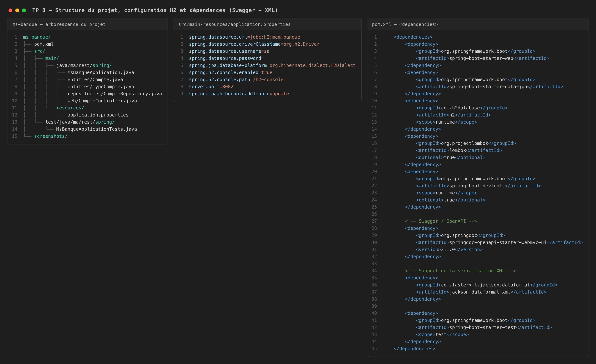
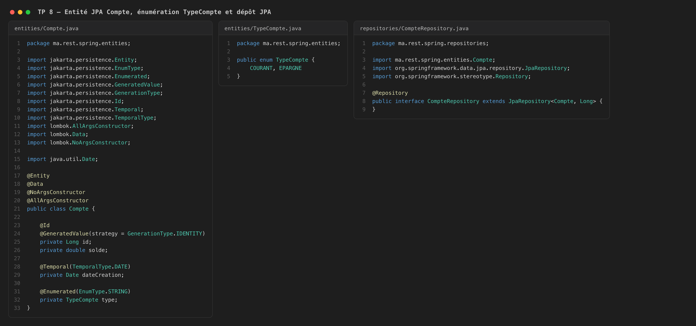
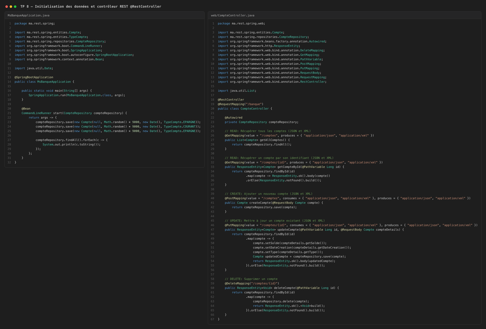
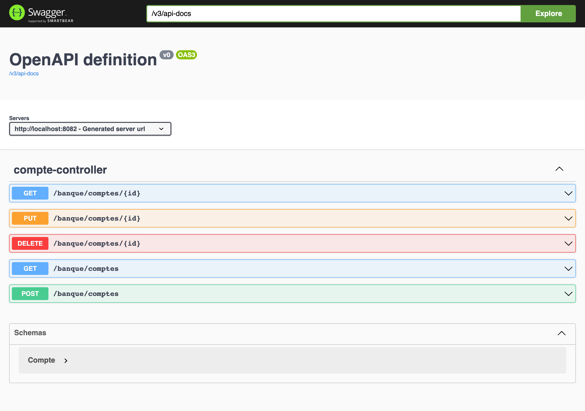
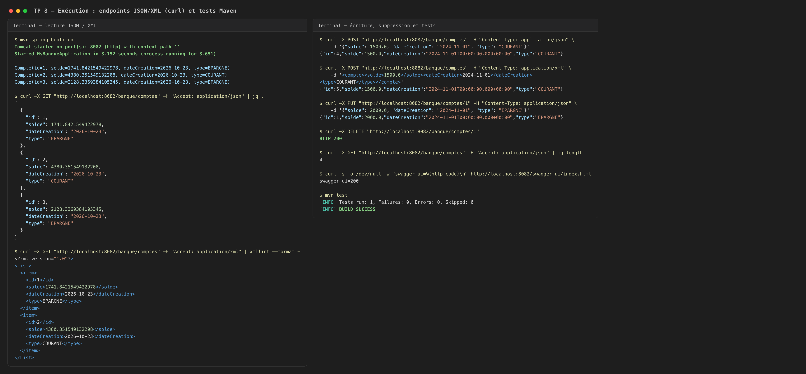

# TP 8 : Spring @RestController

Application Spring Boot `ms-banque` exposant une API REST construite avec `@RestController` sur une base H2 en mémoire, avec documentation Swagger (springdoc-openapi) et sérialisation des réponses en JSON **et** en XML. Le projet contient l'entité `Compte`, l'énumération `TypeCompte`, le `CompteRepository` JPA, un `CommandLineRunner` qui initialise trois comptes et le `CompteController` (`@RequestMapping("/banque")`) offrant les cinq opérations CRUD.

## 1. Structure du projet, configuration H2 et dépendances

## 2. Entité JPA Compte, énumération TypeCompte et dépôt JPA

## 3. Initialisation des données et contrôleur REST

## 4. Documentation Swagger UI

## 5. Exécution : endpoints JSON/XML et tests

